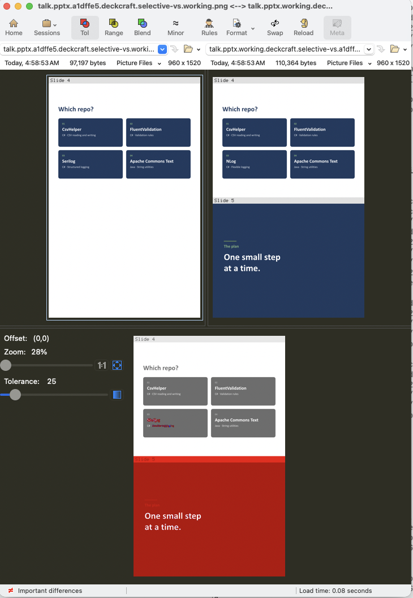

#  PowerPointCompareForGit

[](https://github.com/LearnWithLlew/PowerPointCompareForGit/actions/workflows/build-and-test.yml)
[](https://www.nuget.org/packages/PowerPointCompareForGit)
[](https://www.nuget.org/packages/PowerPointCompareForGit)

**See the slides you changed, side by side.**



*A 60-slide deck with one slide edited and one added. The diff shows just those two.*

```bash
CreatePowerpointCheckpoint talk.pptx --compare --selective
```

> **Status:** early development. All commands work; the detected diff-tool commands are not yet verified on every OS.

## How to read the picture

- **Left** is the older version and **right** is the newer one.
- **Gray bands** show each slide's real number in its own deck.
- **A blank** means the slide doesn't exist on that side, so it was added or removed.
- **Moved slides aren't shown,** because they didn't change. They're listed in the terminal as `Slides moved but unchanged: 19→23, 20→24.`
- **Speaker notes, animations and transitions** aren't in the images, so changes to them won't show.

## Install

```bash
dotnet tool install --global PowerPointCompareForGit
```

The first compare sets up two things:
- **Slide drawing:** slides are drawn by [DeckCraft](https://github.com/storytold/deckcraft), and the tool offers to install it if it's missing.
- **Diff tool:** you choose a PNG-capable diff tool. It suggests any it finds (Beyond Compare, Kaleidoscope, P4Merge, Araxis Merge, WinMerge), or you can enter a custom command such as `mytool --flags {file1} {file2}`.

Your answer is saved to `~/.createpowerpointcheckpoint/settings.json`.

## Usage

```bash
CreatePowerpointCheckpoint talk.pptx --compare --selective            # only the changed slides: uncommitted edits vs last commit, or the last two commits if there are no edits
CreatePowerpointCheckpoint talk.pptx --compare oslo --selective       # working copy vs a sha, tag or branch
CreatePowerpointCheckpoint talk.pptx --compare oslo berlin --selective  # one version vs another
CreatePowerpointCheckpoint talk.pptx --compare                        # every slide, not just the changed ones
CreatePowerpointCheckpoint talk.pptx --compare --pages 2-25           # only slides 2 to 25, stitched into one PNG per version
CreatePowerpointCheckpoint talk.pptx                                  # write a PNG of the last commit that changed the deck, and open nothing
CreatePowerpointCheckpoint talk.pptx --commit sha1,sha2,sha3          # write a PNG of each of these commits
CreatePowerpointCheckpoint talk.pptx --pages 40                       # write a PNG of only slide 40; past the end means the last slide
CreatePowerpointCheckpoint talk.pptx --renderer LibreOffice           # draw with LibreOffice instead of DeckCraft
CreatePowerpointCheckpoint --reset                                    # clear local settings
```

`--selective` can't be combined with `--pages`. Previews are cached in `.git/pptx-previews/`, so git never tracks them and each commit is rendered only once.

## For AI agents

[skills/powerpoint-compare/SKILL.md](../../skills/powerpoint-compare/SKILL.md) is an [Agent Skill](https://agentskills.io) that teaches coding agents how to use this tool. Copy the `powerpoint-compare` folder into your agent's skills directory (e.g. `.claude/skills/`).

## License

Apache-2.0. See [LICENSE](../../LICENSE).
